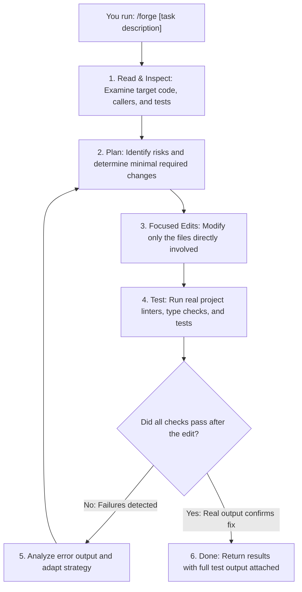

# FORGE

Brings the engineering discipline of Claude models to Gemini Flash in Antigravity: read files before touching code, plan changes around real risks, run actual tests, and prove every completion with concrete evidence.

[](LICENSE)
[](https://antigravity.google)
[](skills/forge/references/typescript-guide.md)
[](skills/forge/references/python-guide.md)
[](CONTRIBUTING.md)
[](CONTRIBUTING.md)

---

## What is Forge?

**Forge** is an open-source skill and runtime for Google Antigravity that brings the thoughtful, step-by-step habits of Claude models directly to Gemini Flash.

Instead of guessing file contents, making uncontrolled edits across your project, or claiming a problem is solved without running checks, Forge puts your agent through a structured developer workflow: explore first, plan carefully, keep changes focused, and run actual tests before reporting back.

---

## The Problem with Default Coding Agents

When working with fast coding models in an agent loop, you frequently run into the same frustrating behaviors:

- **Rushing into edits:** Changing code without reading the surrounding imports, existing functions, or project conventions.
- **Uncontrolled scope:** Modifying files all across your codebase when a bug only existed in a single function.
- **Phantom fixes:** Saying "I fixed the issue!" when the model never actually ran your test suite or compiler.
- **Repeating mistakes:** Running the exact same failed command again and again, wasting your time and session quota.
- **Unverified assumptions:** Trusting its own internal guess rather than real computer output.

These aren't flaws with the model's intelligence—they happen because the agent lacks an enforced engineering workflow.

---

## Why Now?

Recent changes in Google Antigravity have reshaped how developers build:

1. **Gemini 3.1 Pro has been removed.**
2. **Claude models (Sonnet and Opus) are being phased out** or restricted to premium enterprise subscriptions, cutting off many developers from the model they trusted for complex engineering tasks.
3. **Gemini 3.8 Flash is now the primary everyday model** available across Antigravity tiers.

Gemini Flash is lightning-fast and remarkably smart. What developers miss about Claude isn't just raw reasoning—it's Claude's **calm, methodical approach**: taking the time to read the files, thinking through edge cases, and double-checking work before answering.

**Forge gives Gemini Flash that exact discipline.** It doesn't change model weights; it gives the agent a clear, mandatory set of engineering habits. You keep the blistering speed and low cost of Gemini Flash, while gaining the caution and reliability you expect from Claude.

---

## How to Use: The `/forge` Slash Command

Once Forge is installed, you can trigger it directly in any Antigravity conversation by typing `/forge`:

```text
/forge Fix the token refresh timeout in src/auth/session.ts and make sure unit tests pass.
```

When you invoke `/forge`, the agent immediately switches into a disciplined workflow:
1. It reads the target files, dependencies, and test suites.
2. It outlines a short plan and assesses potential risks.
3. It limits edits strictly to the relevant files.
4. It executes your real compiler, linter, and tests.
5. It only reports completion once it has fresh proof that your checks passed.

---

## Quick Installation

You can install Forge in whichever way fits your setup:

### 1. Project Skill via `skills.sh` (Recommended)

From your project directory in Antigravity IDE, install the skill with one command:

```bash
# Add to current workspace (.agents/skills/forge/)
npx skills add faizanio/Forge --skill forge --agent antigravity --yes

# Or install globally for all Antigravity projects on your machine
npx skills add faizanio/Forge --skill forge --agent antigravity --global --yes

# For the Antigravity CLI (agy)
npx skills add faizanio/Forge --skill forge --agent antigravity-cli --yes
```

To update whenever new improvements are pushed:
```bash
npx skills update forge --project --yes
```

### 2. Native Antigravity Plugin

For automated enforcement where Antigravity hooks (`PreToolUse`, `PostToolUse`, `Stop`) mechanically verify tools and gate completion:

```bash
git clone --depth 1 https://github.com/faizanio/Forge.git
cd Forge
bash scripts/build-native-bundle.sh
agy plugin install "$PWD/dist/forge-antigravity"
agy plugin validate "$PWD/dist/forge-antigravity"
```

### 3. Local Installer Script

If you cloned this repository directly and want a fast setup without external tools:

```bash
# Install to current project workspace
./install.sh --workspace

# Install globally to ~/.gemini/config/skills/forge
./install.sh --global

# Interactive menu
./install.sh
```

For more details and troubleshooting, see the [Installation Guide](docs/install.md).

---

## Core Engineering Principles

Forge holds the agent accountable to six fundamental habits:

| Habit | What It Means | Why It Matters |
|---|---|---|
| **1. Inspect Before Writing** | The agent must read target files, callers, and existing tests before making any changes. | Stops blind edits and broken assumptions before they happen. |
| **2. Stay Inside the Lines** | Changes are restricted to files declared in the task scope. | Prevents accidental edits in unrelated parts of your project. |
| **3. Prove Every Claim** | A task is only finished when automated tests pass *after* the final edit. | Eliminates "it should work" assumptions and stale test results. |
| **4. Learn From Errors** | If a command fails, the agent must change its diagnosis or approach before trying again. | Prevents endless, frustrating retry loops. |
| **5. Fulfill the Task Contract** | The agent must satisfy the specific goal and test criteria requested by the user. | Passing unrelated tests doesn't count as solving the bug. |
| **6. Be Honest About Doubts** | Anything that cannot be verified by running a tool must be clearly labeled as unverified. | Gives you transparent truth instead of manufactured confidence. |

---

## How It Works



### Without Forge vs. With Forge

| Behavior | Gemini Flash Without Forge | Gemini Flash with Forge |
|---|---|---|
| **Initial Approach** | Often writes code right away without looking at existing patterns. | **Always reads first:** Inspects existing code and test suites before touching anything. |
| **Planning** | May dive straight into multi-file changes without considering blast radius. | **Thinks first:** Drafts a clear plan outlining the exact steps and potential risks. |
| **Scope Management** | Might touch unrelated configuration or package files when confused. | **Stays focused:** Confines modifications strictly to the files needed for the task. |
| **Testing** | Relies on verbal reassurance ("this looks correct") or tests run too early. | **Verifies with code:** Runs your actual test suite *after* changes are written. |
| **Handling Errors** | Tends to repeat identical failing commands, burning quota and context. | **Adapts intelligently:** Diagnoses error messages and modifies the approach. |
| **Reporting Results** | Claims "all done!" without receipts. | **Shows the evidence:** Provides terminal outputs, test counts, and exit codes. |

---

## Supported Stacks

Forge includes built-in guides and verification patterns for the two most common languages in modern development:

### TypeScript & JavaScript
- Strict type checking with `tsc --noEmit`
- Lint checks with ESLint (`@typescript-eslint`)
- Test runners: Vitest (`vitest run`) and Jest (`jest --verbose`)
- Enforces strict mode best practices (`noUncheckedIndexedAccess`, proper handling of `undefined`, type guards over type casts)
- Read the full [TypeScript Guide](skills/forge/references/typescript-guide.md)

### Python
- Type validation with `mypy --strict` and `pyright`
- Blazing fast linting and formatting checks with `ruff`
- Automated test suites with `pytest -v` (fixtures, parameterized testing, error assertions)
- Clean Python standards (avoiding bare `except`, preventing builtin shadowing, type annotations)
- Read the full [Python Guide](skills/forge/references/python-guide.md)

---

## Built-In Verification Scripts

Forge includes standalone helper scripts to inspect projects and run checks locally:

```bash
# Detect project type, source files, and available test commands
python3 skills/forge/scripts/detect_project.py .

# Test your Forge skill installation health
python3 skills/forge/scripts/doctor.py

# Run the complete verification chain for your project
bash skills/forge/scripts/verify.sh
```

---

## Open Source & Community

Forge is an open-source project created for developers who want higher reliability from their AI coding tools.

Whether you are:
- Looking to get better, safer coding results out of Gemini Flash in Antigravity,
- Learning how **Antigravity Skills** and agent runtimes work under the hood,
- Or wanting to contribute new language guides, improved prompts, or verification scripts...

**Anyone interested in building or learning skills for AI agents is welcome to contribute!**

See our [Contributing Guide](CONTRIBUTING.md) to get involved.

---

## Repository Structure

```text
skills/forge/ (and .agents/skills/forge/)
├── SKILL.md                  # Main skill definition loaded when you type /forge
├── PROMPT-TEMPLATE.md        # 3-layer prompt structure (System, Task, Context)
├── SESSION_FAILURES.md       # Tracks failed attempts to prevent repeat mistakes
├── references/               # Detailed documentation loaded progressively
│   ├── typescript-guide.md   # TypeScript strict practices & test patterns
│   ├── python-guide.md       # Python mypy, ruff, and pytest patterns
│   ├── task-contract.md      # Goal setting and acceptance criteria
│   ├── reasoning.md          # Calibrating how deeply the agent reasons
│   ├── reconnaissance.md     # Techniques for mapping unfamiliar codebases
│   ├── verification.md       # Hierarchy of evidence and testing rules
│   ├── delegation.md         # Subagent collaboration patterns
│   └── recovery.md           # Preserving state across long sessions
├── resources/                # Defensive guidelines and prompt checklists
│   ├── anti-rationalization.md # Catches common shortcuts and excuses
│   ├── adversarial-critique.md # Helps the agent challenge its own plan
│   ├── gemini-native.md      # Tailored to Gemini's native strengths
│   └── persona-protocol.md   # Disciplined engineering persona
├── agents/                   # Specialized agent prompts
│   ├── explore.md            # Read-only exploration and mapping
│   ├── plan.md               # Planning and risk assessment
│   ├── general.md            # Focused code implementation
│   └── verify.md             # Independent test verification
└── scripts/                  # Executable project helpers
    ├── verify.sh             # Multi-language verification runner
    ├── run-checks.sh         # Fast automated checks
    ├── forge_verify.py       # Auto-discovery for project test suites
    ├── verify.py             # Python verification execution
    ├── detect_project.py     # Scans project languages and tests
    └── doctor.py             # Installation health check
```

---

## License & Community

- **License**: Released under the [MIT License](LICENSE).
- **Contributing**: Check out our [Contributing Guide](CONTRIBUTING.md).
- **Code of Conduct**: We adhere to the [Contributor Covenant](CODE_OF_CONDUCT.md).
- **Security**: For responsible disclosure, please review our [Security Policy](SECURITY.md).
