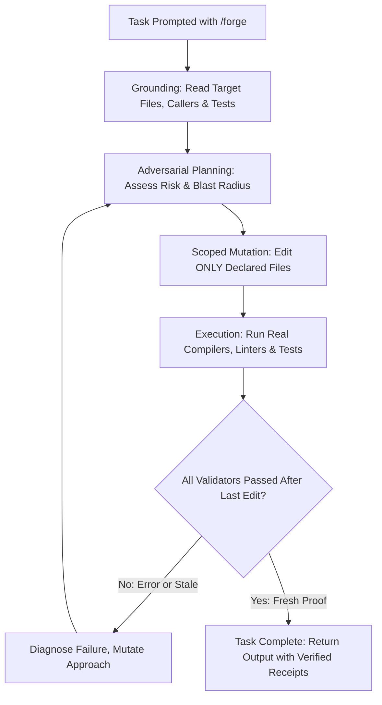

# FORGE

Give Gemini Flash models Claude-grade engineering discipline: inspect before writing, plan proportional to risk, verify with executed proof, and report only what the evidence supports.

[](LICENSE)
[](https://antigravity.google)
[](skills/forge/references/typescript-guide.md)
[](skills/forge/references/python-guide.md)
[](CONTRIBUTING.md)
[](CONTRIBUTING.md)

---

## About

**Forge** is an open-source reliability runtime and agent skill for Google Antigravity. It transforms everyday agentic models into disciplined, top-tier engineering partners. Instead of guessing edits, touching unrelated files, or prematurely declaring tasks complete, Forge forces the agent to read existing files first, plan within bounded blast radiuses, test changes against real compilers and test suites, and back up every single claim with concrete execution output.

---

## The Problem

Coding agents fail in predictable ways:
- **Blind mutations:** They edit files they never read or inspected.
- **Scope creep:** They make broad, unexpected changes across unrelated packages for narrow tasks.
- **Premature celebration:** They announce "done" without running tests, or run tests *before* their final edit and report outdated passing results.
- **Retry loops:** They repeat the exact command that just failed without changing diagnosis or strategy.
- **Unchecked claims:** They produce convincing prose claiming an issue is fixed when no runtime record exists to support it.

These are **process failures**, not intelligence failures. The underlying model is capable of doing the right thing, but without structural constraints, nothing in the agent loop enforces it.

---

## Why Now?

Google Antigravity has adjusted model availability:
1. **Gemini 3.1 Pro has been removed.**
2. **Claude models (Sonnet / Opus) are being phased out** or restricted to high-tier plans, leaving developers without access to the Claude reasoning models they built their workflows around.
3. **What remains accessible to everyone is Gemini 3.8 Flash:** an ultra-fast, capable agentic model.

However, developers consistently miss Claude's methodical coding discipline. **Forge bridges this gap.** 

Forge does not alter model weights—it alters the engineering loop. By enforcing grounded file inspection, scoped editing, and mandatory validation gates, **Forge makes Gemini Flash code with the same precision, caution, and reliability as Claude models**.

---

## Quick Start: Using `/forge`

Once installed, invoke Forge directly in Antigravity chat:

```text
/forge Fix the session expiration bug in auth/session.ts and verify with tests.
```

The agent will ground itself, draft an adversarial plan, scope mutations, execute project tests, and provide verified evidence before completion.

---

## Installation

Forge offers three simple installation options:

### 1. Core Skill (Recommended)

Install directly as an Agent Skill using `skills.sh`. No dependencies beyond the skill files:

```bash
# Workspace install (creates .agents/skills/forge/ in current project)
npx skills add faizanio/Forge --skill forge --agent antigravity --yes

# Global install (available across all projects in Antigravity)
npx skills add faizanio/Forge --skill forge --agent antigravity --global --yes

# For Antigravity CLI (agy)
npx skills add faizanio/Forge --skill forge --agent antigravity-cli --yes
```

To update later:
```bash
npx skills update forge --project --yes
```

### 2. Native Plugin (Antigravity Runtime Hooks)

For teams that want tool calls mechanically checked and gated by Antigravity runtime hooks (`PreToolUse`, `PostToolUse`, `PostInvocation`, and `Stop` gates):

```bash
git clone --depth 1 https://github.com/faizanio/Forge.git
cd Forge
bash scripts/build-native-bundle.sh
agy plugin install "$PWD/dist/forge-antigravity"
agy plugin validate "$PWD/dist/forge-antigravity"
```

### 3. Local Installer (`install.sh`)

If you cloned or downloaded this repo directly and prefer a fast, offline install:

```bash
# Install to current project workspace (.agents/skills/forge)
./install.sh --workspace

# Install globally to Antigravity config (~/.gemini/config/skills/forge)
./install.sh --global

# Interactive menu
./install.sh
```

For complete setup guides and troubleshooting, see [docs/install.md](docs/install.md).

---

## The 6 Invariants

These six rules are non-negotiable. Every action taken under Forge adheres to them:

| # | Invariant | Consequence |
|---|---|---|
| **1** | **Ground before mutating** | The agent reads the target, its tests, and its callers before editing. Code state is observed, never assumed. |
| **2** | **Stay in declared scope** | Each task declares `allowed_write_scope`. Outside writes are denied. If scope is too narrow, amend it openly. |
| **3** | **Completion needs evidence** | A criterion is done only when an automated check passed *after* the final mutation. Stale runs and prose summaries do not count. |
| **4** | **Never exact-retry a failure** | A failed attempt may not be repeated byte-identically. The agent must change diagnosis, context, or approach first. |
| **5** | **Satisfy the contract** | Acceptance criteria and required tests gate task completion. Passing unrelated unit tests proves nothing about the task. |
| **6** | **Say what you cannot verify** | Claims without proof are explicitly marked as unverified. Uncertainty is reported honestly instead of fabricating confidence. |

---

## How It Works



### Gemini Flash Alone vs. Gemini Flash with Forge

| Stage | Gemini Flash Alone | Gemini Flash + Forge |
|---|---|---|
| **File Reading** | Often jumps straight into writing without inspecting imports or caller context. | **Enforced read-before-write:** Cannot modify existing files without recorded inspection. |
| **Planning** | May skip planning on complex multi-file changes or lose track of edge cases. | **Calibrated planning:** Emits structured risk plans (`direct`, `compact`, `deep`) proportional to blast radius. |
| **Write Scope** | Can modify arbitrary files across the repository when confused. | **Strict write boundary:** Mutates only files declared within `allowed_write_scope`. |
| **Testing** | Often claims code "should work", or runs tests before the final edit. | **Fresh proof execution:** Executes real type checks and test suites *after* edits land. |
| **Failures** | Repeats identical failing commands in loops, burning context and quota. | **Anti-retry guard:** Identical retries blocked until diagnosis or strategy changes. |
| **Completion** | Declares "done" based on internal confidence and prose descriptions. | **Evidence Stop gate:** Refuses completion without actual zero-exit command receipts. |

---

## Supported Stacks

Forge comes out-of-the-box with specialized patterns for the two most critical languages in modern software engineering:

### TypeScript & JavaScript
- Strict type checking with `tsc --noEmit`
- Linter validation with `eslint` (`@typescript-eslint`)
- Test suite execution with `vitest run` or `jest --verbose`
- Strict tsconfig rules: `noUncheckedIndexedAccess`, `exactOptionalPropertyTypes`
- Anti-patterns: `any` avoidance, discriminated unions, type guards

### Python
- Type verification with `mypy . --strict` or `pyright`
- Fast linting and format checking with `ruff`
- Automated test execution with `pytest -v` (fixtures, parameterized edge cases)
- Anti-patterns: bare `except` elimination, builtin shadowing prevention, dataclass/Pydantic typing

---

## Proofs & Evidence Model

In Forge, a claim of completion requires verifiable receipts:
1. **Command Provenance**: The exact command executed on your machine (`tsc`, `pytest`, `npm test`, etc.).
2. **Freshness Invariant**: The test run must have timestamped *strictly after* the latest file mutation. A pass recorded before an edit is considered stale.
3. **Unambiguous Verdict**: Every verification output must culminate in:
   ```text
   VERDICT: PASS
   ```
   or
   ```text
   VERDICT: FAIL -- [specific reason and trace]
   ```
   Partial passes or "passed with caveats" are treated strictly as failures.

---

## Benchmark & Reliability Status

Forge's protocols are verified against multi-language suites testing:
- Read-before-write enforcement
- File boundary protection (preventing path traversal and unexpected deletions)
- Anti-retry fingerprinting across failed commands
- Deterministic edge-case boundary expansion (empty inputs, nulls, unicode, numeric limits)
- Stale-pass rejection gates

Run local diagnostics at any time to verify your Forge installation:

```bash
# Verify project detection & available validators
python3 skills/forge/scripts/detect_project.py .

# Check Forge skill installation health
python3 skills/forge/scripts/doctor.py

# Run full project verification chain
bash skills/forge/scripts/verify.sh
```

---

## Open Source & Community Contributions

Forge is an open-source project created for the entire AI engineering community. 

Whether you are:
- An engineer looking to make agentic coding reliable in your daily work,
- A developer exploring how **Agent Skills** work under the hood in Antigravity,
- Or someone interested in contributing new language guides, validator scripts, or multi-agent prompts...

**Contributions are warmly welcome!** Check out our [Contributing Guide](CONTRIBUTING.md) to get started.

---

## Directory Structure

```text
skills/forge/ (and .agents/skills/forge/)
├── SKILL.md                  # Main skill entrypoint (invoked via /forge)
├── PROMPT-TEMPLATE.md        # 3-layer prompt system (System, Task, Context)
├── SESSION_FAILURES.md       # Session failure memory preventing retry loops
├── references/               # Deep progressive documentation
│   ├── typescript-guide.md   # TypeScript strict patterns & failure modes
│   ├── python-guide.md       # Python mypy, ruff, pytest patterns
│   ├── task-contract.md      # Formal task contract specification
│   ├── reasoning.md          # Calibrated reasoning depth
│   ├── reconnaissance.md     # Codebase mapping techniques
│   ├── verification.md       # Evidence hierarchy & VERDICT rules
│   ├── delegation.md         # Subagent delegation rules
│   ├── recovery.md           # Resumption after context compaction
│   └── model-routing.md      # Budget & model escalation
├── resources/                # Defensive guidelines
│   ├── anti-rationalization.md # Defenses against 20 common model excuses
│   ├── adversarial-critique.md # Plan attacking checklist
│   ├── gemini-native.md      # Gemini agent orchestration advantages
│   ├── persona-protocol.md   # Disciplined engineering persona
│   └── subagent-patterns.md  # Multi-agent role templates
├── agents/                   # Multi-agent prompts
│   ├── explore.md            # Read-only exploration agent
│   ├── plan.md               # Adversarial planning agent
│   ├── general.md            # Core implementation agent
│   └── verify.md             # Independent verification agent
└── scripts/                  # Standalone verification utilities
    ├── verify.sh             # Multi-language verification runner
    ├── run-checks.sh         # Fast automated checks
    ├── forge_verify.py       # Standalone project validator discovery
    ├── verify.py             # Python verification runner
    ├── detect_project.py     # Project language & test scanner
    └── doctor.py             # Installation health doctor
```

---

## Community & Security

- **Contributing**: Read our [Contributing Guide](CONTRIBUTING.md) to report issues or propose improvements.
- **Code of Conduct**: We uphold the [Contributor Covenant](CODE_OF_CONDUCT.md).
- **Security Policy**: Please review our [Security Policy](SECURITY.md) to report vulnerabilities responsibly.
- **License**: Released under the [MIT License](LICENSE).
